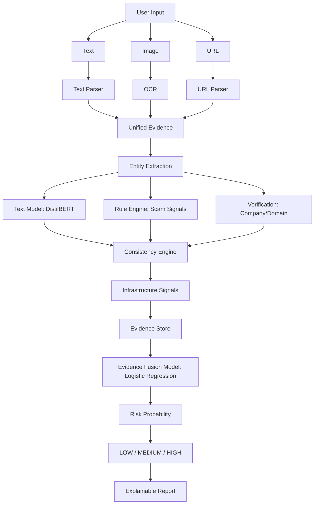

# Project Architecture

The architecture of this project is a direct implementation of the "Evidence-Grounded Multimodal AI for Job Scam Detection and Company Verification" pipeline as outlined in the 2026 survey paper.

## Core Pipeline Flow

1. **Text & Image Parsing**: Extracts text from unstructured descriptions and OCR from images.
2. **Entity Extraction**: Identifies key entities like company, recruiter, email, phone, domain, URL, and salary.
3. **Scam Indicators (Rules Engine)**: Evaluates rule-based signals.
4. **Verification Features**: Checks company/domain validity.
5. **Consistency Features**: Checks for cross-source consistency.
6. **Infrastructure Signals**: Evaluates hosting/domain behavior.
7. **Unified Evidence & Fusion**: Uses Logistic Regression over the evidence to produce calibrated risk scores.

